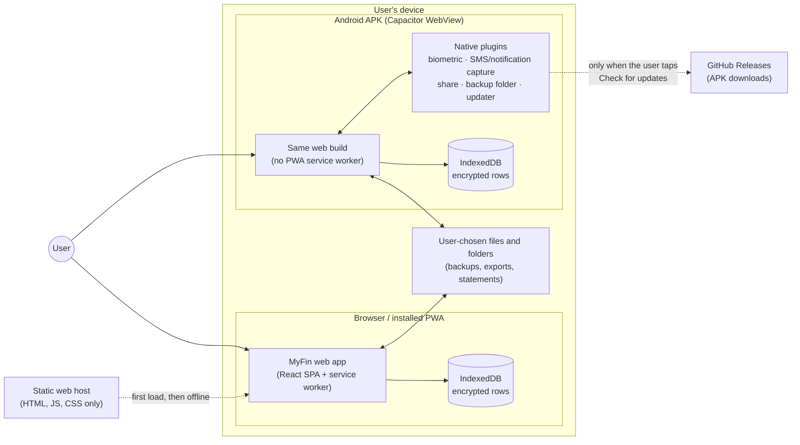
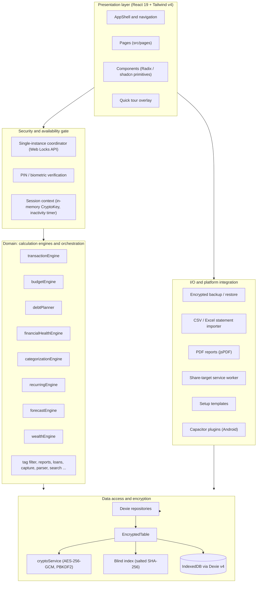

# MyFin — High-Level Design (HLD)

What MyFin is made of, where each part runs, and why it is built this way. Read this before the code;
read the [LLD](LLD.md) when you need modules, data flows and the native Android layer.

**Contents:** [1. Purpose](#1-purpose-and-scope) · [2. System context](#2-system-context) · [3. Design principles](#3-design-principles) · [4. Architecture](#4-architecture-overview) · [5. Runtime targets](#5-runtime-targets) · [6. Security model](#6-security-model) · [7. Data and storage](#7-data-and-storage) · [8. Technology stack](#8-technology-stack) · [9. Constraints](#9-constraints-and-non-goals)

---

## 1. Purpose and scope

MyFin is an **offline-first, zero-knowledge personal finance manager**: a double-sided ledger with
accounts, budgets, recurring items, debt and savings planning, investments, net worth and reports.
Every financial record is encrypted on the device before it is written to IndexedDB. There is no
backend, no account and no telemetry.

It ships in two forms from one code base:

- a **Progressive Web App** (installable, works offline after the first load), and
- an **Android APK**: the same web build inside a Capacitor WebView, plus a few local native plugins
  (fingerprint unlock, bank-message capture, share sheet, backup folder, in-app updates).

This document covers the system as a whole. Per-feature behaviour is in the
[feature catalog](../product/FEATURES.md).

---

## 2. System context

- The **web layer talks only to its own origin** (to load the app and, for the PWA, to check for a new
  version). The Content-Security-Policy injected at build time sets `connect-src 'self'`, so even a
  script-injection bug cannot send data to another origin.
- The **only outbound call** is the Android updater, made by native code (not the page) to the
  GitHub API and release download of this repository, and only when the user presses the button.
- Data leaves the device only as files the user chooses to create: encrypted backups, CSV/Excel
  exports, PDF reports.

---

## 3. Design principles

Many comments in the source cite "Constitution Principle I–VI". That was the project charter kept
under `.specify/` while the project was built with Spec Kit. The setup was removed from the
repository (commit `97fb84a`); its content that still binds the design is below, so every such
reference resolves here. The full original text is in history:
`git show 97fb84a^:.specify/memory/constitution.md`.

| #   | Principle                                              | What it means today                                                                                                                                                                                                                                                                                                                                                                                                    |
| :-- | :----------------------------------------------------- | :--------------------------------------------------------------------------------------------------------------------------------------------------------------------------------------------------------------------------------------------------------------------------------------------------------------------------------------------------------------------------------------------------------------------- |
| I   | **Local-first, zero-server**                           | No backend of the project's own and no server-side processing of user data. The app is fully functional offline after the first load. A server component is out of scope. The charter also allowed an _opt-in_ sync of the encrypted backup to the user's own cloud storage; that is **not implemented**.                                                                                                              |
| II  | **Privacy and encryption by default** (non-negotiable) | All records at rest are AES-GCM encrypted with a key derived from the PIN. The PIN is never stored (only a salted verifier). No financial data in logs, console output or error messages. The derived key is never persisted in an extractable form; the one exception is a **non-extractable** `CryptoKey` handle that lets an unlocked session survive a page reload until the auto-lock time.                       |
| III | **Layered architecture**                               | UI → domain → data → crypto/storage. Domain and data code never import UI code. See [LLD §2](LLD.md#2-layers-and-dependency-rules) for the rule as it is actually enforced and its known deviations.                                                                                                                                                                                                                   |
| IV  | **Test-first for financial logic** (non-negotiable)    | Anything that computes money (the transaction, budget, recurring and net-worth engines and the Quick Add parser) has unit tests; repositories have integration tests; core money flows have Playwright tests. Derived analytics engines follow the same bar. See [TESTING](../testing/TESTING.md).                                                                                                                     |
| V   | **Free and open source only**                          | No paid API or proprietary SaaS dependency; static hosting; CI on GitHub Actions.                                                                                                                                                                                                                                                                                                                                      |
| VI  | **Data integrity**                                     | Money is an integer in the smallest currency unit, never a float. Ids are UUIDs. Import and restore run duplicate detection before committing. Destructive actions need an explicit confirmation. _Superseded clause:_ the charter asked for soft deletes with a Trash; deletes are now **permanent** (schema v15 dropped `deletedAt`, the Trash page was removed) and every delete confirms that it cannot be undone. |

Two further conventions follow from these and are enforced in review:

- **Functional core, imperative shell**: calculations live in plain functions under `src/domain/`
  that take data and return data, so they can be tested without a database or a DOM.
- **One write path**: persistent user data goes through `EncryptedTable` (see
  [LLD §3](LLD.md#3-data-layer)); nothing financial is written to `localStorage`, `sessionStorage` or
  a plaintext IndexedDB column.

---

## 4. Architecture overview

Everything above runs in the page. The only code outside it is the Android native layer
([LLD §6](LLD.md#6-android-native-layer)) and the hand-written share-target service worker.

---

## 5. Runtime targets

|                      | Web / PWA                                                                               | Android APK                                                                                       |
| :------------------- | :-------------------------------------------------------------------------------------- | :------------------------------------------------------------------------------------------------ |
| Build                | `npm run build`                                                                         | `npm run build -- --mode capacitor`, then `cap sync` and Gradle ([BUILD](../deployment/BUILD.md)) |
| Service worker       | Yes (Workbox precache, update prompt) + share-target worker                             | **No.** Disabled so an old bundle can never outlive an app update                                 |
| Fingerprint unlock   | WebAuthn PRF extension                                                                  | Android `BiometricPrompt` + Keystore key (native plugin)                                          |
| Export / backup      | Browser download; scheduled backups via the File System Access folder picker (Chromium) | Android share sheet; scheduled backups into a folder chosen with Android's folder picker          |
| Bank-message capture | Quick Add (paste) and Web Share Target                                                  | Quick Add, share sheet **and** automatic SMS / notification capture                               |
| Reminders            | Browser Notifications API                                                               | Android local notifications                                                                       |
| Updates              | Service-worker update prompt                                                            | In-app check against GitHub Releases                                                              |
| Data location        | Browser profile                                                                         | App-private WebView storage (`allowBackup="false"`)                                               |

The platform is detected at run time (`src/lib/native/platform.ts`); web code calls thin wrappers in
`src/lib/native/` and falls back to the browser API when no plugin is present.

---

## 6. Security model

### 6.1 Cryptography

| Primitive               | Implementation                                                           | Purpose                                                                                                                                                                                       |
| :---------------------- | :----------------------------------------------------------------------- | :-------------------------------------------------------------------------------------------------------------------------------------------------------------------------------------------- |
| Cipher                  | AES-256-GCM, unique 96-bit IV per record                                 | Authenticated encryption of every record                                                                                                                                                      |
| Key derivation          | PBKDF2-HMAC-SHA256                                                       | **210,000** iterations for the on-device key (runs on every unlock; backed by an attempt lockout); **600,000** for backup files, which leave the device and can be attacked offline           |
| Biometrics              | WebAuthn PRF (browser) · Android BiometricPrompt + Keystore (APK)        | Releases a secret that unwraps the PIN. Never a replacement for the PIN                                                                                                                       |
| Captured messages (APK) | RSA-2048 OAEP (SHA-1) wrapping a per-message AES-256-GCM key             | Native receivers can only _seal_; the private key is stored encrypted with the PIN-derived key, so messages open only after unlock                                                            |
| Searchable encryption   | Blind index: SHA-256 of a per-installation salt plus the lowercased text | Exact-match lookup of merchant aliases and tags without readable text in an IndexedDB index. A salted hash, not a keyed MAC: it removes bulk readability, not confirmation of a guessed value |
| Integrity               | SHA-256 checksums                                                        | Verified on backup restore and template import                                                                                                                                                |

Only the Web Crypto API is used; there is no cryptography dependency.

### 6.2 Session and key lifecycle

- **Locked** → the user enters the PIN or uses biometrics → a `CryptoKey` is derived and held in
  memory → **Unlocked**, with an inactivity timer (default 5 minutes, configurable).
- On timeout or explicit lock the in-memory key and the persisted non-extractable handle are
  discarded. In the Android app, **Security → Auto-lock → Lock when I leave the app** additionally
  locks it after 30 seconds in the background.
- The master PIN is never kept in React state, so it cannot leak into React DevTools or a heap
  snapshot.
- A PIN is 6–12 digits. After 4 free attempts each wrong PIN locks entry for an escalating time, up
  to 5 minutes (`src/domain/auth/pinPolicy.ts`).

### 6.3 Threat matrix

| Threat                                                              | Mitigation                                                                                                                                                                                                                                                             |
| :------------------------------------------------------------------ | :--------------------------------------------------------------------------------------------------------------------------------------------------------------------------------------------------------------------------------------------------------------------- |
| **Device theft or storage extraction**                              | Everything in IndexedDB is AES-256-GCM ciphertext. Without the PIN or the biometric key it is random noise.                                                                                                                                                            |
| **XSS or a malicious extension**                                    | In-memory key only, strict CSP with `connect-src 'self'` (no exfiltration path), console output disabled in production (`disableConsoleInProd.ts`), single-instance isolation.                                                                                         |
| **Concurrent multi-tab corruption**                                 | The Web Locks coordinator allows exactly one tab to unlock the database; others show `BlockedScreen`. A browser without the Web Locks API is let through (fail open) rather than blocked for good.                                                                     |
| **Tampered database or corrupt backup**                             | SHA-256 checksums and GCM authentication tags detect tampering before any restored record is committed.                                                                                                                                                                |
| **Search leakage on encrypted fields**                              | Salted blind indexing keeps merchant and tag text out of readable indexes.                                                                                                                                                                                             |
| **Phone stolen while locked, bank messages already captured (APK)** | The queue holds only sealed boxes; the private key that opens them is encrypted with the PIN-derived key. The "N new transactions" alert never shows an amount or merchant and is private on the lock screen.                                                          |
| **Stale or invalidated fingerprint enrollment (APK)**               | The Keystore key is invalidated when fingerprints change; a wrapped PIN that no longer opens is dropped and never counts as a wrong attempt. The PIN always remains.                                                                                                   |
| **Unrelated personal messages reaching MyFin (APK)**                | A coarse native filter drops anything that cannot be about money, one-time codes, and texts from personal numbers that do not read like a bank alert, before anything is stored. Notifications are read only from a fixed list of payment, banking and messaging apps. |

Vulnerability reporting is described in [SECURITY.md](../../SECURITY.md).

---

## 7. Data and storage

- **Store:** IndexedDB through Dexie v4 (`src/data/dexie/db.ts`).
- **Row shape:** every table except the user profile stores a few plaintext _structural_ columns that
  must stay indexed (account id, date, review status, parent id ...) plus one `encryptedData` blob
  holding the AES-GCM ciphertext of the **whole** entity. A decrypted row is therefore
  self-describing, and amounts, notes and names never touch disk unencrypted.
- **Unencrypted by design** (4 of the 35 tables): `userProfile` (salt, PIN verifier, wrapped
  biometric secrets, preferences) because it is needed before a key exists; `sessionKeys` (the
  non-extractable key handle, protected by non-extractability rather than ciphertext);
  `autoBackupSettings` (the backup schedule and folder handle); and `transactionTags`, a pure join
  table of opaque UUIDs.
- **Schema evolution:** Dexie schema versions 1–15, mostly additive (a few carry a data upgrade,
  such as v8's blind indexes and v15 dropping the soft-delete column). New optional fields are added
  _inside_ the encrypted entity, which needs no schema bump. Backup files carry their own format
  version and are upgraded by the chain in `src/data/io/migrations/`.
- **Backups:** one encrypted JSON file with all tables, salt metadata and checksums. Optional
  scheduled backups write the same file into a folder the user picks (Android) or a File System
  Access handle (desktop).

---

## 8. Technology stack

| Concern              | Choice                                                                                                          |
| :------------------- | :-------------------------------------------------------------------------------------------------------------- |
| UI                   | React 19, React Router v7 (`BrowserRouter`), Tailwind CSS v4, Radix UI / shadcn components, Lucide icons        |
| Language             | TypeScript 6, strict                                                                                            |
| Build                | Vite 8, `vite-plugin-pwa` (Workbox)                                                                             |
| Storage              | Dexie 4 over IndexedDB                                                                                          |
| Crypto               | Web Crypto API (SubtleCrypto)                                                                                   |
| Forms and validation | react-hook-form, zod                                                                                            |
| Import / export      | PapaParse, ExcelJS, jsPDF + jspdf-autotable, file-saver                                                         |
| Charts               | Chart.js (line charts) and plain HTML/CSS bars for the rest                                                     |
| Android              | Capacitor 8 (`core`, `app`, `filesystem`, `local-notifications`, `share`) plus five local plugins in `android/` |
| Tests                | Vitest (node and jsdom projects), Testing Library, fake-indexeddb, Playwright, JUnit for the Java code          |
| CI                   | GitHub Actions: `ci.yml` (checks and tests) and `build-apk.yml` (APK and release)                               |

---

## 9. Constraints and non-goals

- **No server, ever** (Principle I). Anything that needs one — shared budgets, bank API sync,
  push notifications — is out of scope.
- **Single device.** Moving to a new phone goes through the encrypted backup, not a sync service.
- **The APK is a sideloaded debug build** signed with a committed debug key (see
  [BUILD](../deployment/BUILD.md#signing-key)). It is not distributed through Google Play.
- **Browser biometrics** need WebAuthn PRF support. PIN unlock works wherever the app runs.
