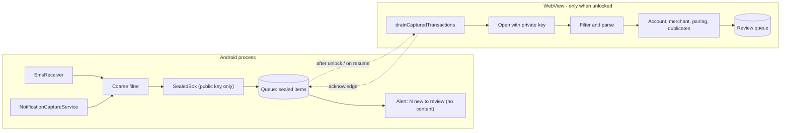
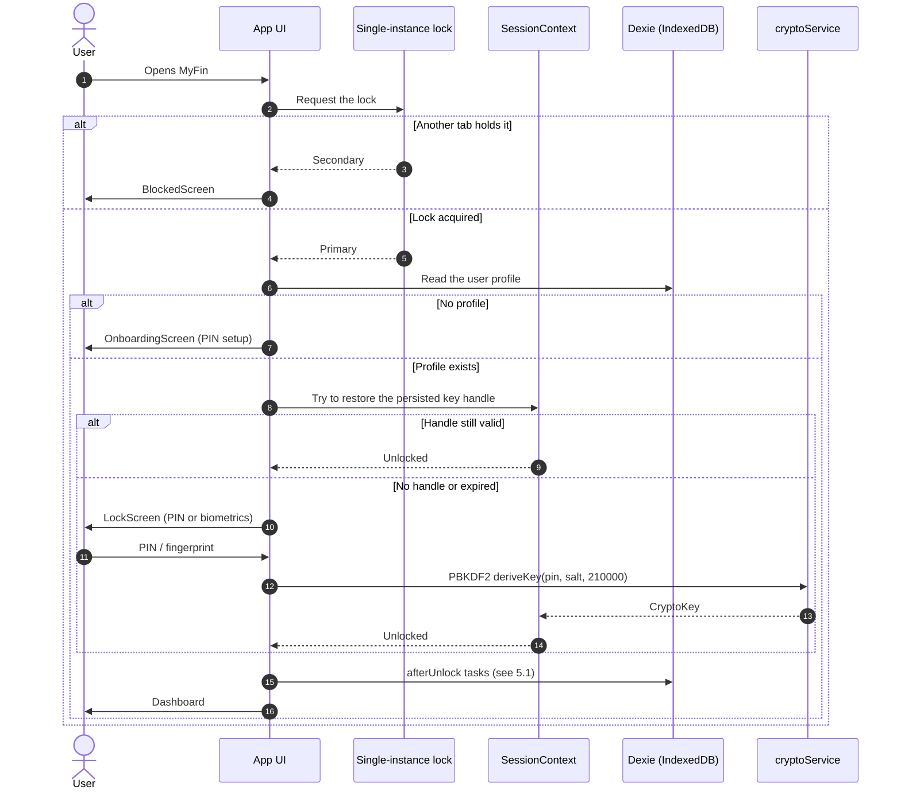

# MyFin — Low-Level Design (LLD)

Modules, layers, data flows and the native Android layer, with the file names to open. The system
as a whole, its principles and its security model are in the [HLD](HLD.md).

**Contents:** [1. Source map](#1-source-map) · [2. Layers and dependency rules](#2-layers-and-dependency-rules) · [3. Data layer](#3-data-layer) · [4. Domain layer](#4-domain-layer) · [5. Application shell](#5-application-shell) · [6. Android native layer](#6-android-native-layer) · [7. Key flows](#7-key-flows) · [8. Recipes](#8-recipes) · [9. Reading old source comments](#9-reading-old-source-comments)

---

## 1. Source map

```text
.
├── src/
│   ├── main.tsx, App.tsx          Entry point; root Gate (lock → onboarding → unlock) and the route table
│   ├── index.css                  Tailwind v4 entry, light and dark theme tokens
│   ├── components/                Shared UI (app-specific components at this level)
│   │   ├── ui/                    shadcn/Radix primitives only (button, dialog, ...) — added with the shadcn CLI
│   │   ├── quick-tour/            Guided onboarding tour: provider, overlay, step list
│   │   ├── categories/            Category editor, remove dialog, icon set
│   │   └── charts/                HTML/CSS charts: BarList, ProgressBar, SegmentedBar, TrendBars
│   ├── pages/                     One component per route (33 files); lazy-loaded except the Dashboard
│   ├── context/SessionContext.tsx In-memory CryptoKey, auto-lock timer, session restore
│   ├── hooks/                     React hooks (app-active, app update, capture sync, media query, ...)
│   ├── lib/                       Framework-level utilities with no business rules
│   │   └── native/                Thin wrappers over the Capacitor plugins; no-ops/fallbacks on the web
│   ├── domain/                    Entities and calculation engines — see §4
│   └── data/
│       ├── crypto/                cryptoService (AES-GCM, PBKDF2, blind index), sealedBox (RSA-OAEP)
│       ├── dexie/                 Schema (db.ts), EncryptedTable helpers, one repository per aggregate
│       ├── io/                    Backup, restore, import, export, templates, PDF, capture ingest, migrations/
│       ├── auth/                  PIN re-check inside the unlocked app, sharing the lock screen's throttle
│       └── storage/               Persistent-storage request
├── tests/
│   ├── unit/                      Pure logic (Vitest, node)
│   ├── integration/               Repositories and services against fake-indexeddb (Vitest, node)
│   ├── component/                 React components (Vitest, jsdom)
│   ├── e2e/                       Playwright specs (+ helpers.ts)
│   ├── fixtures/                  Shared fixtures, incl. the Java-sealed capture sample
│   └── setup/                     Vitest setup files
├── public/                        Static files copied as-is: icons, favicon, robots.txt, sw-share-target.js
├── android/                       Capacitor Android project + local native plugins (Java) and JUnit tests
├── docs/                          This documentation
└── *.config.ts / tsconfig*.json   Vite/Vitest, Playwright, Capacitor, TypeScript, ESLint, Prettier
```

Naming conventions: React components and pages are `PascalCase.tsx`; every other module is
`camelCase.ts`; `components/ui/` keeps shadcn's `kebab-case.tsx`; tests mirror the module under test
as `<module>.test.ts(x)`; Playwright specs are `<feature>.spec.ts` (`*.mobile.spec.ts` run on the
phone profile). Imports inside `src/` are relative; the `@/` alias (→ `src/`) is used by shadcn-generated code.

---

## 2. Layers and dependency rules

```text
pages, components, hooks, context        presentation
            │
            ▼
         domain          entities, engines, orchestration that reads through repositories
            │  ▲
            ▼  │ (types)
          data           repositories, EncryptedTable, crypto, import/export
            │
            ▼
   Dexie / IndexedDB / Web Crypto

   lib/   shared utilities and native wrappers, importable from every layer
```

Rules that hold today and are worth keeping (checked against the import graph):

- `domain/`, `data/` and `lib/` **never import** from `components/`, `pages/`, `hooks/` or `context/`.
- Nothing in the UI reads IndexedDB outside a repository; the one exception is
  `components/quick-tour/QuickTourProvider.tsx`, which counts accounts and transactions through `db`
  to decide whether the tour should start.
- Money is an integer in the smallest currency unit everywhere; format only at the edge
  (`domain/shared/money.ts`).
- Persistent user data is written through `EncryptedTable` ([§3](#3-data-layer)).
- Web Crypto (`crypto.subtle`) is called only from `data/crypto/` and the two key-wrapping helpers
  `lib/pinWrap.ts` and `lib/webauthn.ts`.

Where the code is looser than the original charter (Principle III):

- `data/` imports **types and a few helpers from `domain/`** (37 files; `entities.ts` lives in
  `domain/`), and **21 of the 63 `domain/` files import repositories or `db`** (the `*Service`
  modules and engines such as `budgetEngine`, `forecastEngine`, `wealthEngine`). So `data` ↔
  `domain` is mutual, not strictly one-way.
- UI code calls repositories directly in 42 files as well as going through domain services.

Treat the pure/orchestrating split in [§4](#4-domain-layer) as the rule that matters: new
calculations go into a pure function that is tested without a database, and the orchestration
around it stays thin.

---

## 3. Data layer

### 3.1 Schema and rows — `src/data/dexie/db.ts`

- Dexie database `myfin`, schema versions 1–15, 35 tables (31 encrypted, 4 plaintext by design — see
  [HLD §7](HLD.md#7-data-and-storage)).
- An encrypted row is `{ id, encryptedData: { iv, ciphertext }, ...structural columns }`. Structural
  columns exist only where a query needs an index, for example `accountId`, `date`, `reviewStatus`,
  `duplicateOfId`, `transferPairId`, `parentId`, `categoryId`, `periodStart`, `status`, `isRead`, and
  the blind-index columns `aliasHash`/`nameHash`.
- IndexedDB rejects `null` as an index key, so absent references are stored as `''`
  (`src/data/dexie/indexable.ts` maps both ways). The in-memory fake used by tests does **not**
  reject `null`, so this bug class only shows up in a real browser — keep going through the mapper.

### 3.2 `EncryptedTable` — `src/data/dexie/encryptedTable.ts`

`encryptRow` builds the row (random IV, AES-256-GCM over the **whole** entity, plus the structural
columns); `putEncrypted`, `getDecrypted` and `decryptRows` are the single-row conveniences.

Atomicity rule: **encrypt first, then open the transaction.** Web Crypto promises are not tracked by
Dexie's transaction zone, so awaiting `encrypt()` inside `db.transaction(...)` causes a
`PrematureCommitError`. Callers that write several tables encrypt every row up front and then `put`
the prebuilt rows inside the transaction.

### 3.3 Repositories

One module per aggregate in `src/data/dexie/*Repository.ts`, each exporting an object of async
methods (for example `TransactionRepository.create(...)`, `UserProfileRepository.get()`). Methods take
the session `CryptoKey` where they read or write encrypted data. Related helpers:

| Module                                          | Role                                                                                                                                                  |
| :---------------------------------------------- | :---------------------------------------------------------------------------------------------------------------------------------------------------- |
| `snapshot.ts`                                   | Raw copy of the stored (still encrypted) rows, so a multi-step write that cannot be one Dexie transaction can roll back (used by the template import) |
| `clearAllTables.ts`                             | The single explicit list of tables a reset or restore clears                                                                                          |
| `blindIndexSalt.ts`, `blindIndexMaintenance.ts` | Per-installation salt; post-unlock backfill of blind-index digests after a schema upgrade (a Dexie upgrade has no key)                                |
| `sessionKeyRepository.ts`                       | The non-extractable session-key handle with its expiry                                                                                                |

### 3.4 I/O services — `src/data/io/`

| Area                   | Modules                                                                                                                                                                                                       |
| :--------------------- | :------------------------------------------------------------------------------------------------------------------------------------------------------------------------------------------------------------ |
| Backup / restore       | `backupService`, `autoBackupService` (scheduled, runs only on an explicit unlock because it needs the PIN), `backupReminderService`, `integrityService` ("Check my data"), `resetService`, `changePinService` |
| Import / export        | `importService` (CSV/XLSX, column mapping, date/sign formats, duplicate detection), `bulkTextImportService`, `exportService`, `reportPdfExport`                                                               |
| Templates              | `templateService`, `templateTypes`, `sampleTemplate`, `starterCategories`                                                                                                                                     |
| Android capture        | `captureIngestService` (file a captured message), `captureDrain` (open the sealed queue after unlock), `captureSetup` (key pair and permissions)                                                              |
| Backup-format upgrades | `migrations/` — `v1.ts` … `v1_5.ts` plus `dropTrashed.ts` for backups made before deletes became permanent                                                                                                    |

---

## 4. Domain layer

`src/domain/` holds the entity types (`entities.ts`) and one folder per business area. It contains
two kinds of module; the distinction is the one to preserve.

**Pure functions** (no `data/` or `lib/` import; 42 files) — deterministic, unit-tested without a
database:

| Folder                                          | Examples                                                                              |
| :---------------------------------------------- | :------------------------------------------------------------------------------------ |
| `shared/`                                       | `money`, `dateMath`                                                                   |
| `parser/`                                       | `quickAddParser`, `cardIdentifierMatcher`, `cardPaymentDetector`, `dateText`          |
| `capture/`                                      | `captureParser`, `captureFilter`, `accountMatcher`, `capturePairing`, `captureMoment` |
| `categorization/`                               | `categorizationEngine`, `keywordMatching`                                             |
| `transactions/`                                 | `tagFilterEngine`, `splitInput`, `editLearning`, `transactionLabel`                   |
| `debtPlanner/`, `savingsGoals/`, `personLoans/` | `generatePlan` (snowball / avalanche), `goalProgress`, `loanProgress`                 |
| `analytics/`, `notifications/`, `reports/`      | `financialHealthEngine`, `dashboardLayout`, `notificationEngine`, `reportEngine`      |
| `auth/`, `search/`                              | `pinPolicy`, `searchIndex`                                                            |

**Orchestrating modules** (read through repositories or `lib/`; 21 files): `transactionEngine`,
`budgetEngine`, `budgetVarianceEngine`, `recurringEngine`, `subscriptionDetectionEngine`,
`forecastEngine`, `wealthEngine`, `categoryEngine`, `analyticsEngine`, `dashboardService`,
`dashboardInsights`, `reportService`, `runNotificationCheck`, `resolveCategorization`,
`merchantResolver`, `accountDeletion`, and similar. They gather data, call the pure functions and
return plain results to the UI.

---

## 5. Application shell

### 5.1 Boot sequence — `src/App.tsx`

`Gate` renders nothing from the app until, in order:

1. **Single-instance lock** (`lib/singleInstance.ts`, Web Locks) → otherwise `BlockedScreen`.
2. **Profile check** — no profile → `OnboardingScreen` (PIN setup, durable-storage request).
3. **Silent session restore** from the non-extractable key handle, if it has not expired.
4. **Lock** → `LockScreen` (PIN, fingerprint, lockout, forgot-PIN).
5. **Unlocked** → `QuickTourProvider` › `BrowserRouter` › `ErrorBoundary` › banners, prompts, bridges
   (`NativeShareBridge`, `AndroidBackHandler`, `NotificationTapHandler`) › `Routes`.

After an unlock (`afterUnlock`) these fire-and-forget tasks run in order, each isolated so one failure
does not stop the next: blind-index maintenance → drain the Android capture queue → recurring/budget
notification check → daily net-worth snapshot → backup reminder sync → purge stale shared payloads.

### 5.2 Routing and pages

Routes are declared once in `App.tsx`; every page except `DashboardPage` is loaded through
`lazyPage()`, which reloads the tab once if a chunk from a replaced build is missing
(`lib/staleChunk.ts`). Navigation structure lives in `components/AppShell.tsx` (`NAV_GROUPS`) and
`lib/hubs.ts` (`HUBS`, the strips of sibling screens on a phone and the folded Data / Automation /
Settings entries). A share into the app lands on `/share-target-landing`, outside `AppShell`.

### 5.3 Session — `src/context/SessionContext.tsx`

Holds the `CryptoKey` in a ref, runs the inactivity timer, persists/restores the non-extractable
handle with its expiry, locks when the app has been in the background longer than the timeout (or
30 s with "Lock when I leave the app"), and exposes `getEncryptionKey()`. The PIN never enters state.

### 5.4 Share target (web) — `public/sw-share-target.js`

A hand-written service worker registered at scope `/share-target`, separate from the Workbox worker.
It intercepts only the `POST /share-target` of the manifest's `share_target`, buffers the shared
text/file in the Cache API with a 24-hour expiry and size limits, and redirects to the landing page.
Its text-priority rule (`text > url > title`) is duplicated from `lib/shareTarget.ts` because a plain
script cannot import it — change both together.

---

## 6. Android native layer

The APK is the web build in a Capacitor WebView plus local plugins in
`android/app/src/main/java/io/github/akhlaquea01/myfin/`. The web layer remains the only place that
holds the data key or reads the database.

| Package      | Classes                                                                                                                                                   | Responsibility                                                                                       |
| :----------- | :-------------------------------------------------------------------------------------------------------------------------------------------------------- | :--------------------------------------------------------------------------------------------------- |
| `biometric/` | `NativeBiometricPlugin`, `BiometricVault`                                                                                                                 | Keystore key that needs a fresh strong-biometric prompt per use; holds the secret that wraps the PIN |
| `capture/`   | `SmsReceiver`, `NotificationCaptureService`, `CaptureFilter`, `SealedBox`, `CaptureQueue`, `CaptureIntake`, `CaptureNotifier`, `TransactionCapturePlugin` | Receive, filter, seal and queue bank messages; raise the content-free "N new" alert                  |
| `share/`     | `NativeSharePlugin`                                                                                                                                       | Hand shared text/files to the web layer                                                              |
| `backup/`    | `NativeBackupFolderPlugin`                                                                                                                                | Scheduled backups into a user-picked folder (Storage Access Framework)                               |
| `update/`    | `NativeAppUpdatePlugin`, `UpdateRules`                                                                                                                    | Check GitHub Releases, download, verify, open the installer                                          |
| (root)       | `MainActivity`                                                                                                                                            | Registers the plugins                                                                                |

Web-side counterparts: `src/lib/native/` (one wrapper per plugin), `src/data/crypto/sealedBox.ts`
(opens sealed items), `src/data/io/capture*.ts`, `src/domain/capture/`.



- **Why sealed boxes.** Receivers run with no PIN, so they cannot write to the encrypted store, and
  they must not leave a message readable (Principle II). When capture is switched on, the web layer
  makes an RSA key pair, gives native code the **public** half and stores the **private** half
  encrypted with the data key. Native code can only seal. A device-bound Keystore key would not be
  PIN-derived and could be used by anything running as the app.
- **Fingerprint.** The plugin generates a random secret and keeps it behind a Keystore key that needs
  a fresh strong-biometric `BiometricPrompt` for every use. The web layer wraps the PIN with that
  secret (`profile.nativeBiometric.wrappedPin`). Unlocking recovers the PIN, which then runs through
  the normal PIN check and key derivation; the PIN never crosses to native code. This follows the
  precedent of `profile.webauthn.wrappedPin`.
- **Idempotency.** Each message is recorded in the notified-items ledger (keyed by a blind-index
  digest of channel, sender, time and text) after its entry is created and before it is acknowledged,
  so a replay is skipped and a crash in between files a _flagged_ duplicate rather than losing a
  transaction. When the message carries a bank reference number (`capture.refNo`, inside the
  encrypted entry) a replay is folded into the entry it already made, which also catches a copy
  re-posted after the ledger row or the entry's review status changed.
- **Verification boundaries.** The web side is covered by unit, integration, component and e2e tests,
  including opening an item sealed by the real Java `SealedBox` (`tests/fixtures/`). The Java code is
  compiled and unit-tested in CI only; the receivers, permission flows and the fingerprint prompt can
  only be checked on a phone.

---

## 7. Key flows

### 7.1 Cold start and unlock



### 7.2 Encrypted write

```mermaid
sequenceDiagram
    autonumber
    actor User
    participant Page as NewTransactionPage
    participant Repo as TransactionRepository
    participant Enc as encryptedTable
    participant Crypto as cryptoService
    participant DB as IndexedDB

    User->>Page: Submit amount, payee, account, category
    Page->>Repo: create(key, input, splits)
    Repo->>Repo: Validate date; splits must sum to the amount
    Repo->>Enc: encryptRow for the transaction and each split
    Enc->>Crypto: random 96-bit IV, AES-256-GCM encrypt(entity)
    Crypto-->>Enc: { iv, ciphertext }
    Repo->>DB: db.transaction → put(prebuilt rows)
    DB-->>Repo: Stored
    Repo-->>Page: Saved
    Page->>User: Toast, navigate to Transactions
```

### 7.3 Review, duplicates and categories (cross-cutting rules)

- **No schema change for new optional fields.** The bank reference number lives in the encrypted
  `capture` object (`CaptureInfo.refNo`); a category's colour is a palette key (`cat-1` … `cat-8`) when
  chosen, otherwise derived from creation order (a subcategory inherits its parent's); purpose, capture
  time and category `kind` are optional encrypted fields. The cross-account duplicate search uses the
  existing `date` index.
- **Duplicate policy.** Everything merely _similar_ (same account, same amount, within a day) is
  created and flagged, never skipped. Only a re-sighting that is provably the same message is folded
  into the entry it belongs to: the same reference number and amount, or the SMS and the payment-app
  notification of one payment. Two different reference numbers, or two accounts that both came from
  the message's own digits, are never folded.
- **Category picker.** `CategoryPicker` is a `role="combobox"` button (so a `<label htmlFor>` still
  names it) opening a `cmdk` list in a popover (md and up) or a bottom `Sheet` (phones). The popover
  content is mounted only while open, so it cannot linger over the control beneath it.
- **Charts** are plain HTML/CSS (`BarList`, `ProgressBar`, `SegmentedBar`, `TrendBars`): sharp at any
  size, testable in jsdom, nothing added to the bundle. Chart.js remains for the line charts. Every
  chart also writes its figures out as text, and `TrendBars` carries a table twin.
- **Phone navigation** is a strip of sibling screens (`hubForPath`) rendered only below `md`; routes
  are unchanged.

---

## 8. Recipes

**Add a page.** Create `src/pages/FooPage.tsx` exporting `FooPage`; add `lazyPage(() => import('./pages/FooPage'), 'FooPage')` and a `<Route>` in `src/App.tsx`; add a link in `AppShell.tsx` (`NAV_GROUPS`) or a hub entry in `lib/hubs.ts`. Search `tests/e2e` for the words in any new label or link first (see [TESTING](../testing/TESTING.md#writing-e2e-specs)).

**Add a field to an existing entity.** Add it as optional to the type in `domain/entities.ts`. It is stored inside the encrypted blob, so no Dexie version is needed; handle `undefined` for old rows. Add a Dexie version only when a new table or an _indexed_ column is needed, and write a data upgrade if existing rows must change.

**Add a table.** Declare the row type and table in `db.ts`, add a new `this.version(n)` (never edit an old one), write a repository using `encryptRow`/`putEncrypted`, add it to `clearAllTables.ts`, and extend the backup format (`backupService.ts`, which lists tables explicitly) and its migration chain. `snapshot.ts` picks new tables up automatically; add the name to its `NOT_DATA` / `DEVICE_LOCAL` sets only if it must be excluded.

**Add a calculation.** Put it in a pure function under the matching `src/domain/<area>/` folder with a unit test; call it from a service or page.

**Add a shadcn component.** `npx shadcn add <name>` (the CLI is a dev dependency, configured by `components.json`); it lands in `src/components/ui/`. Keep app-specific components out of that folder.

**Add a native plugin.** Java class in `android/.../myfin/<area>/`, registered in `MainActivity`; a typed wrapper in `src/lib/native/` that degrades gracefully on the web (`isNativePluginAvailable`); JUnit tests for any pure logic (they run in `build-apk.yml`).

---

## 9. Reading old source comments

Comments written while the project was specified with Spec Kit cite documents that no longer exist in
the working tree. They are still in git history:

| Comment says                                                                  | Means                                                                         | Where to find it                                                                                                         |
| :---------------------------------------------------------------------------- | :---------------------------------------------------------------------------- | :----------------------------------------------------------------------------------------------------------------------- |
| `Constitution Principle I`–`VI`                                               | The project charter                                                           | Summarised in [HLD §3](HLD.md#3-design-principles); full text: `git show 97fb84a^:.specify/memory/constitution.md`       |
| `spec 0NN`, `Feature 0NN`, `User Story n`                                     | The feature that introduced the code                                          | [FEATURES](../product/FEATURES.md) (same numbering)                                                                      |
| `FR-0nn`, `SC-0nn`, `research.md`, `contracts/*`, `data-model.md`, `tasks.md` | Requirements, research notes, interface contracts and tasks of those features | Deleted in commit `9e0789a`; browse with `git ls-tree -r 9e0789a^ specs/` and read with `git show 9e0789a^:specs/<path>` |

Treat the comment itself, the tests and the feature catalog as the live record; the historical
documents explain intent but may describe behaviour that has since changed (for example soft deletes).
